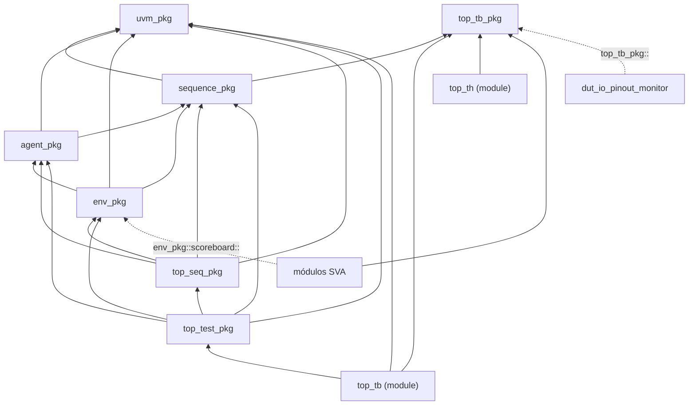
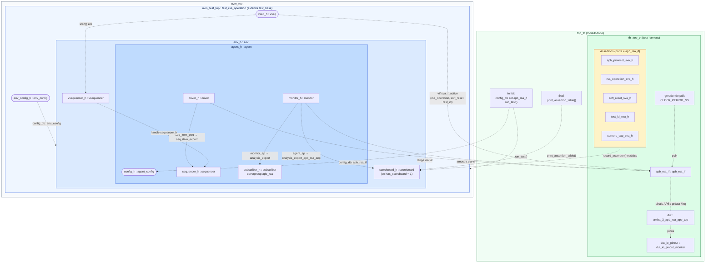
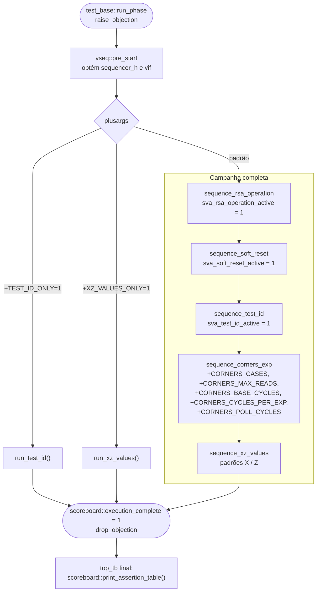

# Estrutura da bancada UVM — RSA_APB

Este documento descreve a organização da bancada UVM do DUT `amba_3_apb_rsa_apb_top`
em cinco visões:

1. [Arquivos, ordem de compilação e conexões](#1-arquivos-ordem-de-compilação-e-conexões)
2. [Dependências entre pacotes](#2-dependências-entre-pacotes)
3. [Hierarquia de componentes e conexões](#3-hierarquia-de-componentes-e-conexões)
4. [Herança de classes](#4-herança-de-classes)
5. [Fluxo da sequência virtual (`vseq`)](#5-fluxo-da-sequência-virtual-vseq)

---

## 1. Arquivos, ordem de compilação e conexões

Os scripts (`scripts/MG/bash/uvm_campaign.sh`) compilam primeiro o RTL do DUT
(`src/MG`, bloco ⓪) e depois **apenas**
`testbench.svh`. Todo o restante da pasta `UVM/` entra por `` `include `` a
partir dele, na ordem numerada abaixo (① → ⑪). Os arquivos incluídos não devem
ser compilados separadamente.

Como ler o diagrama:

| Elemento | Significado |
|---|---|
| Caixa | arquivo ou pasta que **contém** os itens desenhados dentro dela |
| Seta cheia com rótulo | hierarquia: o bloco de origem **instancia/cria** o de destino; o rótulo é o nome da instância |
| Seta grossa | sinais físicos entre a interface e o DUT |
| Seta tracejada | acesso por `vif`/handle, `uvm_config_db`, `extends`, chamadas estáticas ou ordem de execução |

A interface `apb_rsa_if` é o ponto de encontro: do lado de cima, o UVM
(`driver`, `monitor`, `vseq`) acessa a interface pelo `vif`. Do lado de baixo,
ela se liga às portas do DUT. O diagrama trata o DUT como caixa-preta: os
módulos internos do APB e do RSA não são detalhados aqui.

```mermaid
flowchart TB
    subgraph ROOT["📁 UVM/"]
        subgraph R0[" "]
            direction LR
            PLAN[/"RSA_APB_Verif_Plan.xlsx<br/>plano de verificação"/]
            DOC[/"estrutura.md<br/>este documento"/]
        end

        subgraph TBH["testbench.svh — raiz da compilação"]

            subgraph TOP["⑪ top_tb.svh — módulo topo"]
                TOP_MOD["module top_tb"]
                TOP_INIT["initial<br/>config_db set: th.apb_rsa_if<br/>run_test()"]
                TOP_FIN["final<br/>print_assertion_table()"]
            end

            subgraph TH["⑩ top_th.svh — test harness"]
                TH_MOD["module top_th<br/>gera pclk (CLOCK_PERIOD_NS)"]
            end

            PIN["⑨ dut_io_pinout.sv<br/>observa só os pinos do dut"]

            subgraph P_IF["① apb_rsa_if.svh — interface apb_rsa_if"]
                IF_APB["sinais APB<br/>presetn · psel · penable · pwrite<br/>paddr[11:0] · pwdata[31:0]<br/>prdata[31:0] · pready · pslverr · irq"]
                IF_CNT["cycle_count<br/>contador de ciclos de pclk"]
                IF_FLAG["flags de verificação (não ligadas ao DUT)<br/>sva_*_active · sva_corners_* · xz_*"]
            end

            subgraph P_TB["② top_tb_pkg.svh"]
                TBP["parâmetros de largura e clock<br/>mapa de registradores<br/>CORNERS_CASES_EXP_*<br/>EXPECTED_ID_VALUE"]
            end

            subgraph P_SEQ["③ sequence_pkg.svh"]
                F_ITEM["uvm_seq_item.sv"]
                F_SEQ["uvm_sequence.sv<br/>apb_base_sequence"]
                F_RSA["uvm_sequence_rsa_operation.sv"]
                F_RST["uvm_sequence_soft_reset.sv"]
                F_ID["uvm_sequence_test_id.sv"]
                F_CRN["uvm_sequence_corners_exp.sv"]
                F_XZ["uvm_sequence_xz_values.sv"]
            end

            subgraph P_AGT["④ agent_pkg.svh"]
                F_AGT["uvm_agent.sv"]
                F_ACFG["agent_config.svh"]
                F_SQR["uvm_sequencer.sv"]
                F_DRV["uvm_driver.sv"]
                F_MON["uvm_monitor.sv"]
                F_SUB["uvm_subscriber.sv"]
            end

            subgraph P_ENV["⑤ env_pkg.svh"]
                F_ENV["uvm_env.sv"]
                F_ECFG["env_config.svh"]
                F_VSQR["uvm_vsequencer.sv"]
                F_SCB["uvm_scoreboard.sv"]
            end

            subgraph P_VSEQ["⑥ top_seq_pkg.svh"]
                F_VSEQ["uvm_vseq.sv"]
            end

            subgraph P_TEST["⑦ top_test_pkg.svh"]
                F_TRSA["uvm_test_rsa_operation.sv"]
                F_TBASE["uvm_test_base.sv"]
            end

            subgraph P_SVA["⑧ assertions/assertions.svh"]
                A_APB["apb_protocol_sva.sv"]
                A_RSA["rsa_operation_sva.sv"]
                A_RST["soft_reset_sva.sv"]
                A_ID["test_id_sva.sv"]
                A_CRN["corners_exp_sva.sv"]
            end
        end
    end

    D_APBTOP["⓪ DUT — amba_3_apb_rsa_apb_top<br/>RTL em src/MG (compilado antes de testbench.svh)"]

    %% ---------- Hierarquia estática: top_tb -> top_th -> interface / DUT / SVAs ----------
    TOP_MOD -- "th" --> TH_MOD
    TH_MOD -- "apb_rsa_if" --> IF_APB
    TH_MOD -- "dut" --> D_APBTOP
    TH_MOD -- "dut_io_pinout" --> PIN
    TH_MOD -- "*_sva_h (5 instâncias)" --> P_SVA

    %% ---------- Interface <-> DUT (sinais físicos) ----------
    IF_APB == "presetn · psel · penable<br/>pwrite · paddr · pwdata" ==> D_APBTOP
    D_APBTOP == "prdata · pready<br/>pslverr · irq" ==> IF_APB

    %% ---------- Hierarquia UVM: test -> env -> agent ----------
    TOP_INIT -- "run_test() → uvm_test_top" --> F_TRSA
    F_TRSA -. "extends" .-> F_TBASE
    F_TBASE -- "env_h" --> F_ENV
    F_TBASE -- "env_config_h" --> F_ECFG
    F_TBASE -- "vseq_h" --> F_VSEQ
    F_ENV -- "vsequencer_h" --> F_VSQR
    F_ENV -- "scoreboard_h" --> F_SCB
    F_ENV -- "agent_h" --> F_AGT
    F_AGT -- "config_h" --> F_ACFG
    F_AGT -- "sequencer_h" --> F_SQR
    F_AGT -- "driver_h" --> F_DRV
    F_AGT -- "monitor_h" --> F_MON
    F_AGT -- "subscriber_h" --> F_SUB
    F_VSEQ -- "start(), na ordem" --> F_RSA
    F_RSA -.-> F_RST -.-> F_ID -.-> F_CRN -.-> F_XZ

    %% ---------- Interface <-> UVM ----------
    TOP_INIT -. "config_db: th.apb_rsa_if" .-> F_ACFG
    F_DRV -. "dirige via vif" .-> IF_APB
    F_MON -. "amostra via vif" .-> IF_APB
    F_VSEQ -. "liga flags (vseq, corners_exp, xz_values)" .-> IF_FLAG

    %% ---------- SVAs ----------
    P_IF -. "observa (porta bus)" .-> P_SVA
    P_SVA -. "record_assertion()" .-> F_SCB
    TOP_FIN -. "print_assertion_table()" .-> F_SCB

    classDef sva fill:#fde68a,stroke:#b45309,color:#3b2300
    classDef mod fill:#dcfce7,stroke:#15803d,color:#052e16
    classDef dut fill:#ddd6fe,stroke:#6d28d9,color:#2e1065
    classDef extra fill:#f3f4f6,stroke:#6b7280,color:#111827
    class A_APB,A_RSA,A_RST,A_ID,A_CRN sva
    class TOP_MOD,TH_MOD,PIN,IF_APB mod
    class D_APBTOP dut
    class PLAN,DOC,IF_FLAG,IF_CNT extra

    style R0 fill:none,stroke:none
    style P_IF fill:#f0fdf4,stroke:#15803d,color:#052e16
    style TH fill:#f0fdf4,stroke:#15803d,color:#052e16
    style TOP fill:#f0fdf4,stroke:#15803d,color:#052e16
    style P_TB fill:#dbeafe,stroke:#1d4ed8,color:#0b1f4d
    style P_SEQ fill:#dbeafe,stroke:#1d4ed8,color:#0b1f4d
    style P_AGT fill:#dbeafe,stroke:#1d4ed8,color:#0b1f4d
    style P_ENV fill:#dbeafe,stroke:#1d4ed8,color:#0b1f4d
    style P_VSEQ fill:#dbeafe,stroke:#1d4ed8,color:#0b1f4d
    style P_TEST fill:#dbeafe,stroke:#1d4ed8,color:#0b1f4d
    style P_SVA fill:#fef3c7,stroke:#b45309,color:#3b2300
```

Sinais entre a interface e o DUT (ligação feita em `top_th.svh`):

| Sinal em `apb_rsa_if` | Porta do DUT | Sentido | Largura |
|---|---|---|---|
| `pclk` (gerado no `top_th`) | `pclk_i` | harness → DUT e interface | 1 |
| `presetn` | `presetn_i` | interface → DUT | 1 |
| `psel` | `psel_i` | interface → DUT | 1 |
| `penable` | `penable_i` | interface → DUT | 1 |
| `pwrite` | `pwrite_i` | interface → DUT | 1 |
| `paddr` | `paddr_i` | interface → DUT | `ADDR_WIDTH` = 12 |
| `pwdata` | `pwdata_i` | interface → DUT | `DATA_WIDTH` = 32 |
| `prdata` | `prdata_o` | DUT → interface | `DATA_WIDTH` = 32 |
| `pready` | `pready_o` | DUT → interface | 1 |
| `pslverr` | `pslverr_o` | DUT → interface | 1 |
| `irq` | `irq_o` | DUT → interface | 1 |

---

## 2. Dependências entre pacotes

Setas indicam `import` (quem importa → quem é importado). Os módulos de SVA não
importam `env_pkg`, mas chamam `env_pkg::scoreboard::record_assertion(...)`
diretamente pelo nome qualificado.

---

## 3. Hierarquia de componentes e conexões

Visão em tempo de simulação. Cada caixa é uma instância que **contém** os
filhos desenhados dentro dela. Nós arredondados são objetos (`uvm_object` /
sequência), não componentes. As setas tracejadas são conexões (TLM, handles,
`uvm_config_db`, interface virtual).

Resumo das conexões:

| Origem | Destino | Mecanismo | Onde |
|---|---|---|---|
| `top_tb` | todos os componentes | `uvm_config_db #(virtual apb_rsa_if)::set(..., "apb_rsa_if", ...)` | `top_tb.svh` |
| `test_base` | `env` | `uvm_config_db #(env_config)::set(..., "env_config", ...)` | `uvm_test_base.sv` |
| `agent` | `driver`, `monitor` | `config_h.vif` atribuído em `connect_phase` | `uvm_agent.sv` |
| `driver.seq_item_port` | `sequencer.seq_item_export` | TLM pull | `uvm_agent.sv` |
| `monitor.monitor_ap` | `subscriber.analysis_export` | analysis port (cobertura) | `uvm_agent.sv` |
| `agent.agent_ap` (= `monitor_ap`) | `scoreboard.analysis_export_apb_rsa_aep` | analysis port | `uvm_env.sv` |
| `vsequencer.sequencer_h` | `agent.sequencer_h` | handle | `uvm_env.sv` |
| módulos SVA | `scoreboard` | métodos `static` (`record_assertion`) | `assertions/*.sv` |
| `vseq` | `apb_rsa_if` | flags `sva_rsa_operation_active`, `sva_soft_reset_active`, `sva_test_id_active` | `uvm_vseq.sv` |
| `sequence_corners_exp`, `sequence_xz_values` | `apb_rsa_if` | obtêm o `vif` via `config_db` e ligam `sva_corners_*` / `xz_values_active` | `uvm_sequence_corners_exp.sv`, `uvm_sequence_xz_values.sv` |

---

## 4. Herança de classes

```mermaid
classDiagram
    direction BT

    class uvm_test
    class uvm_env
    class uvm_agent
    class uvm_driver~seq_item~
    class uvm_monitor
    class uvm_sequencer~seq_item~
    class uvm_subscriber~seq_item~
    class uvm_scoreboard
    class uvm_sequence_item
    class uvm_sequence~seq_item~
    class uvm_object

    class test_base {
        env env_h
        env_config env_config_h
        vseq vseq_h
    }
    class test_rsa_operation
    class env {
        env_config env_config_h
        vsequencer vsequencer_h
        scoreboard scoreboard_h
        agent agent_h
    }
    class agent {
        agent_config config_h
        monitor monitor_h
        sequencer sequencer_h
        driver driver_h
        subscriber subscriber_h
        uvm_analysis_port agent_ap
    }
    class driver
    class monitor {
        uvm_analysis_port monitor_ap
    }
    class sequencer
    class vsequencer {
        sequencer sequencer_h
    }
    class subscriber {
        covergroup apb_rsa
    }
    class scoreboard {
        uvm_analysis_imp analysis_export_apb_rsa_aep
        static record_assertion()
        static report_sequence_result()
        static print_assertion_table()
    }
    class seq_item {
        transaction_type_t transaction_type
        logic[31:0] data
        logic[11:0] address
        logic pslverr
    }
    class agent_config {
        virtual apb_rsa_if vif
    }
    class env_config {
        bit has_scoreboard
        agent_config config_h
    }
    class vseq {
        sequencer sequencer_h
        env env_h
        run_test_id()
        run_xz_values()
    }
    class apb_base_sequence
    class sequence_rsa_operation
    class sequence_soft_reset
    class sequence_test_id
    class sequence_corners_exp
    class sequence_xz_values

    uvm_test <|-- test_base
    test_base <|-- test_rsa_operation
    uvm_env <|-- env
    uvm_agent <|-- agent
    uvm_driver <|-- driver
    uvm_monitor <|-- monitor
    uvm_sequencer <|-- sequencer
    uvm_sequencer <|-- vsequencer
    uvm_subscriber <|-- subscriber
    uvm_scoreboard <|-- scoreboard
    uvm_sequence_item <|-- seq_item
    uvm_object <|-- agent_config
    uvm_object <|-- env_config
    uvm_sequence <|-- vseq
    uvm_sequence <|-- apb_base_sequence
    uvm_sequence <|-- sequence_rsa_operation
    apb_base_sequence <|-- sequence_soft_reset
    apb_base_sequence <|-- sequence_test_id
    apb_base_sequence <|-- sequence_corners_exp
    apb_base_sequence <|-- sequence_xz_values
```

> `vseq` estende `uvm_sequence` sem parâmetro; as demais sequências usam
> `uvm_sequence #(seq_item)`.

---

## 5. Fluxo da sequência virtual (`vseq`)

`test_base::run_phase` inicia `vseq_h` no `vsequencer`. A `vseq` lê os plusargs,
ajusta `scoreboard::active_scenario` e executa cada sequência no `sequencer` do
agente. As flags de SVA de `rsa_operation`, `soft_reset` e `test_id` são ligadas
pela própria `vseq`; `corners_exp` e `xz_values` ligam as suas internamente.

Relação entre cenário, flag na interface e módulo de assertions:

| Sequência | Flag em `apb_rsa_if` | Módulo SVA |
|---|---|---|
| *(sempre ativo; também verifica que no máximo um cenário está ativo)* | — | `apb_protocol_sva` |
| `sequence_rsa_operation` | `sva_rsa_operation_active` | `rsa_operation_sva` |
| `sequence_soft_reset` | `sva_soft_reset_active` | `soft_reset_sva` |
| `sequence_test_id` | `sva_test_id_active` | `test_id_sva` |
| `sequence_corners_exp` | `sva_corners_exp_active` e demais `sva_corners_*` | `corners_exp_sva` |
| `sequence_xz_values` | `xz_values_active` (contexto, sem SVA dedicada) | — |
